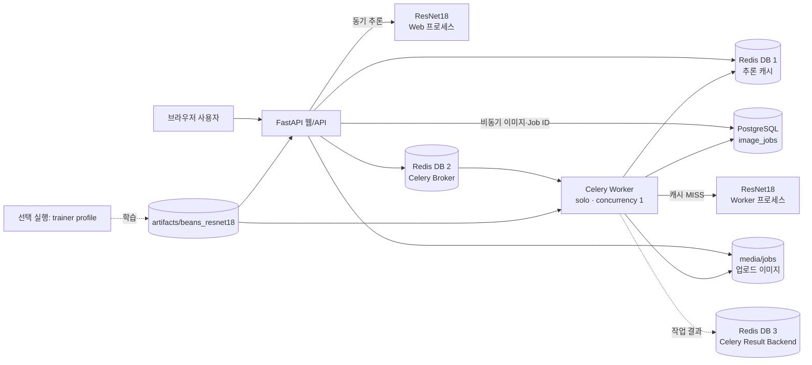

# 시스템 아키텍처

## 전체 구성

## 구성요소 및 실행 위치

| 구성요소 | 실행 위치·역할 | 저장·연결 |
|---|---|---|
| 브라우저 화면 | 사용자가 동기·비동기 페이지에서 이미지를 업로드하고 결과를 확인 | FastAPI의 `/vision/sync/`, `/vision/async/` |
| FastAPI `web` | Docker Compose 컨테이너. 화면/API 제공, 입력 검사, 동기 추론, 비동기 작업 등록·상태 조회 | 포트 `127.0.0.1:8000`; 내부에서 PostgreSQL·Redis에 연결 |
| Redis | Docker 컨테이너. DB 1은 추론 결과 캐시(600초 TTL), DB 2는 Celery 작업 전달, DB 3은 Celery 결과 backend | 포트 `127.0.0.1:6379` |
| PostgreSQL | Docker 컨테이너. 비동기 `image_jobs` 상태와 분류 결과 저장 | 포트 `127.0.0.1:5432`; Docker 볼륨에 데이터 보존 |
| Celery `worker` | 별도 Docker 컨테이너. 큐에서 Job ID를 받아 이미지 처리 후 DB 갱신 | `solo` pool, 동시성 1 |
| ResNet18 모델 | `web`와 `worker` 프로세스에서 각각 필요할 때 로드. 현재 구현은 CPU(`device=-1`) 추론 | 모델 경로는 `MODEL_PATH`; 기본값 `artifacts/beans_resnet18` |
| 이미지·모델 파일 | 컨테이너와 프로젝트 폴더 사이 bind mount | 업로드는 `media/jobs/`, 모델은 `artifacts/` |
| `trainer` | Compose의 선택 프로필 `train`으로 실행하는 별도 학습 서비스. 일반 서비스 기동에는 포함되지 않음 | `dataset/`은 읽기 전용, 결과는 `artifacts/beans_resnet18` |

## 요청 흐름

- **동기 흐름**: 브라우저 이미지 전송 → 파일 형식·크기·해상도 검사 → Redis 조회 → HIT면 저장 결과 반환 / MISS면 Web 모델 추론 후 캐시 저장·결과 반환.
- **비동기 흐름**: 입력 검사·`media/jobs/` 저장 → PostgreSQL `queued` 생성 → Redis Broker에 Job ID 전달 → HTTP 202 반환 → Worker `running` 처리·캐시 조회·필요 시 추론 → 결과와 `done` 상태 저장 → 브라우저 상태 조회.
- 입력 제한: JPG·PNG·WEBP, 5MB 이하, 1,200만 픽셀 이하. 부적합 이미지는 작업 등록 전 거부.

## 실행 환경과 범위

- Compose 서비스: `redis`, `postgres`, `web`, `worker`. `trainer`는 `train` 프로필에서만 실행.
- Dockerfile: Python 3.11, CPU용 PyTorch.
- Web·Worker: 같은 이미지·모델 경로 사용, 별도 프로세스에서 모델 각각 로드.
- 포트: `127.0.0.1` 바인딩. 재시작 정책 `unless-stopped`.
- Redis·PostgreSQL 데이터와 Hugging Face 캐시: Docker 볼륨 저장.
