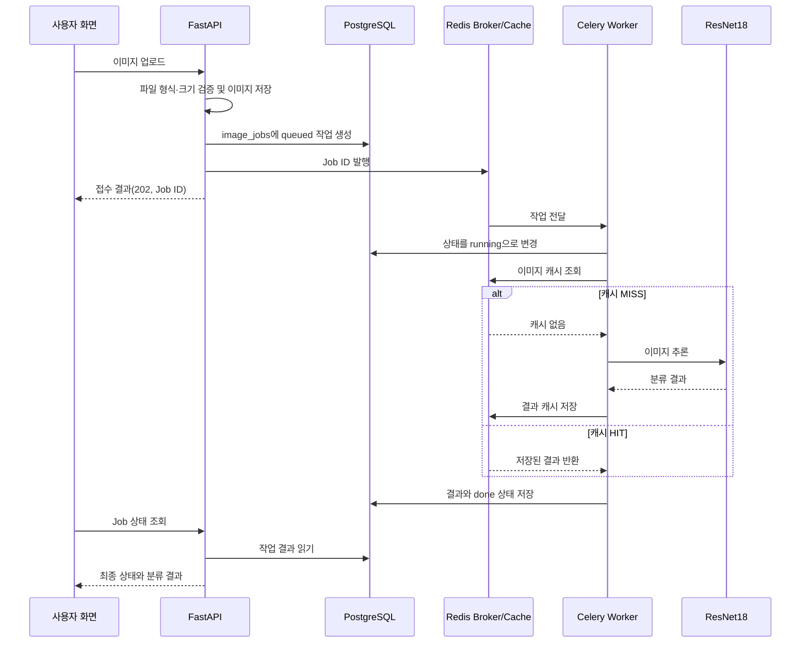

# AI 버튼 처리 흐름

## 동기

브라우저 업로드 → FastAPI 입력 검증 → Redis 캐시 조회 → MISS면 ResNet18 추론·캐시 저장 → 결과 JSON 반환

## 비동기

브라우저 업로드 → FastAPI 입력 검증·이미지 저장 → PostgreSQL에 `queued` 행 기록 → Celery Broker에 Job ID 전달 → HTTP 202와 Job ID 반환 → Worker가 Redis 조회 후 MISS면 ResNet18 추론 → PostgreSQL에 결과와 `done` 상태 저장 → 브라우저가 상태 API를 조회해 최종 결과 표시

## Validation에서 확인한 결과

- 동기 검증: Validation 이미지 3건 모두 HTTP 200, Top-1 정답 일치.
- 캐시 확인: `bean_rust_val.27.jpg` MISS·HIT 결과 동일한 오분류. HIT의 `inference_ms=null`.
- 비동기 검증: Job 15–17 모두 `done`. PostgreSQL 결과와 응답 JSON 일치.
- 증빙: `reports/evidence/`. 반복 성능 측정: Validation 이미지 5장.
